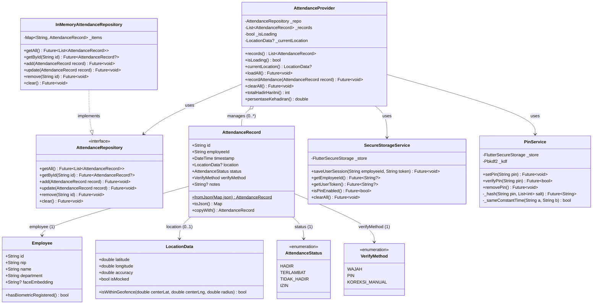

# Pemodelan Class Diagram & Arsitektur Sistem
**Aplikasi:** AWALI (Absensi WAjah dan LokasI) — Presensi Pegawai  
**Milestone:** M02 — Spesifikasi Kebutuhan & Desain Arsitektur (`m02-spec`)  
**Penyusun:** Tim Pengembang AWALI  

---

## 1. Pendahuluan

Class Diagram memodelkan struktur data logis dan rancangan arsitektur berorientasi objek yang menjadi cetak biru langsung kode Dart pada Milestone M04. Desain ini menerapkan prinsip *Separation of Concerns* (pemisahan tanggung jawab antarmuka, logika bisnis, dan sumber data) melalui **Repository Pattern** dan **Provider Pattern**, sekaligus memastikan kepatuhan penuh terhadap prinsip minimisasi data UU PDP (data biometrik wajah dimodelkan sebagai representasi vektor numerik, bukan citra foto mentah).

---

## 2. Diagram Class Lengkap (Mermaid)

---

## 3. Penjelasan Struktur Model dan Lapisan Arsitektur

### 3.1 Model Data Domain
1. **`AttendanceRecord` (`lib/models/attendance_record.dart`):**  
   Mewakili satu transaksi rekaman presensi pegawai. Menyimpan atribut unik (`id`), pengenal pegawai (`employeeId`), stempel waktu sistem (`timestamp`), objek posisi geografis (`location`), status kehadiran (`status`), serta metode verifikasi yang digunakan (`verifyMethod`).
2. **`Employee` (`lib/models/employee.dart`):**  
   Mewakili entitas profil pegawai. Atribut `faceEmbedding` menyimpan nilai vektor numerik hasil ekstraksi algoritma visi komputer (*face embedding 128/512-float vector*). **Tidak ada atribut yang menyimpan file foto mentah**, menjamin kepatuhan mutlak terhadap prinsip minimisasi data UU PDP (`PRV-01`).
3. **`LocationData` (`lib/models/location_data.dart`):**  
   Menyimpan titik koordinat lintang/bujur dan radius akurasi horizontal. Method `isWithinGeofence()` melakukan kalkulasi jarak menggunakan formula *Haversine* untuk memastikan apakah posisi berada dalam radius $\le 50$ meter dari kantor. Atribut `isMocked` mendeteksi manipulasi lokasi tiruan (Fake GPS).

---

### 3.2 Lapisan Data & Repository Pattern (`lib/repositories/`)
* **`AttendanceRepository` (Kontrak Interface):**  
  Mendefinisikan operasi standar manipulasi data: `getAll()`, `getById()`, `add()`, `update()`, `remove()`, dan `clear()`. Kontrak ini menjadi dinding isolasi: layar UI tidak pernah mengetahui apakah data tersimpan di memori lokal, SQLite, atau cloud server.
* **`InMemoryAttendanceRepository` (Implementasi M01–M04):**  
  Menyimpan rekaman presensi dalam struktur `Map<String, AttendanceRecord>` di memori lokal perangkat.
* **Kesiapan M05 (`FirestoreAttendanceRepository`):**  
  Pada Milestone M05, implementasi Firestore akan mengimplementasikan interface `AttendanceRepository` yang sama persis tanpa perlu mengubah satu baris pun kode antarmuka UI.

---

### 3.3 Lapisan State Management (`lib/providers/attendance_provider.dart`)
* Menggunakan pustaka resmi Flutter `ChangeNotifierProvider`.
* Bertindak sebagai jembatan tunggal antara penyimpanan data dan antarmuka layar (`HomeScreen`, `AttendanceScreen`, `HistoryScreen`).
* Method `clearAll()` mengoordinasikan pemusnahan data di repository dan reset memori provider untuk memenuhi hak penghapusan data (`PRV-03`).

---

### 3.4 Layanan Keamanan Kriptografis (`lib/services/`)
* **`SecureStorageService` (`SEC-01`):**  
  Mengamankan kredensial NIP, sesi autentikasi, dan status keamanan pada hardware-backed Keystore (Android) / Keychain (iOS).
* **`PinService` (`SEC-02`):**  
  Menerapkan fungsi derivasi kunci **PBKDF2-HMAC-SHA256** (120.000 iterasi) dengan salt acak 16-byte kriptografis dan verifikasi perbandingan waktu-konstan (*constant-time equality check*) untuk mencegah eksploitasi *timing attack*.

---

## 4. Multiplisitas dan Aturan Bisnis

* **`AttendanceRecord (0..*) ── (1) Employee`:**  
  Satu pegawai dapat memiliki banyak rekaman riwayat presensi sepanjang masa dinas, namun setiap catatan presensi hanya dimiliki oleh tepat satu pegawai.
* **`AttendanceRecord (1) ── (0..1) LocationData`:**  
  Catatan presensi reguler wajib menyertakan koordinat lokasi saat penekanan tombol presensi. Pada kasus pengajuan koreksi presensi atau dispensasi izin khusus, koordinat bersifat opsional (`0..1`).
* **`AttendanceProvider (1) ── (0..*) AttendanceRecord`:**  
  Provider memegang koleksi daftar riwayat presensi aktif yang ditampilkan pada layar UI.
