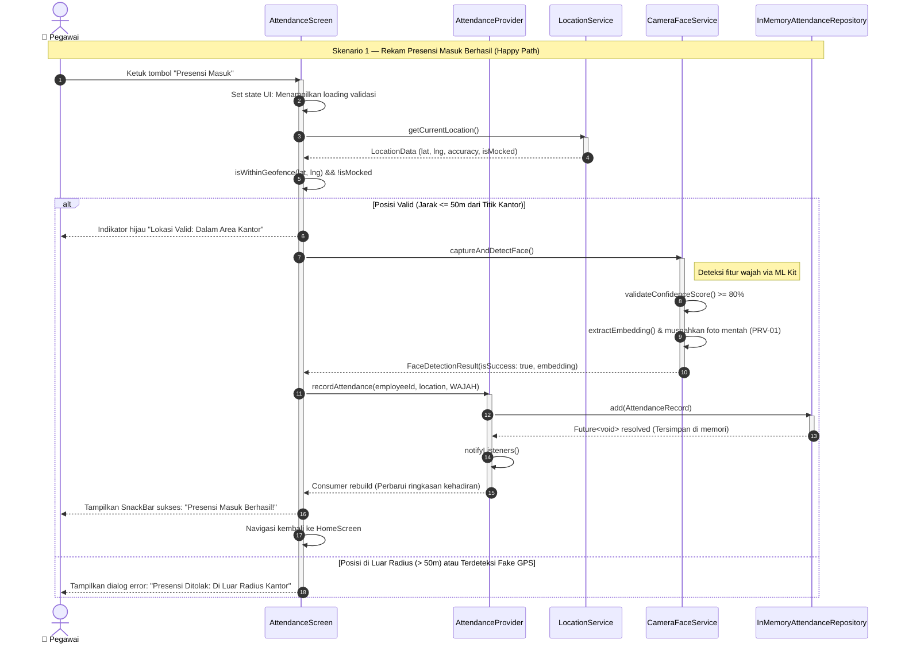

# Sequence Diagram — Skenario 1: Rekam Presensi Berhasil (Happy Path)
**Aplikasi:** AWALI (Absensi WAjah dan LokasI) — Presensi Pegawai  
**Milestone:** M02 — Spesifikasi Kebutuhan & Desain Arsitektur (`m02-spec`)  
**ID Kebutuhan Terkait:** `FR-03`, `FR-04`, `FR-05`, `PRV-01`  
**Penyusun:** Tim Pengembang AWALI  

---

## 1. Deskripsi Skenario

Skenario ini menggambarkan alur utama (*Happy Path*) saat pegawai melakukan presensi kehadiran masuk harian melalui smartphone di area kantor. Seluruh tahapan validasi berjalan sukses:
1. Pegawai membuka layar presensi dan menekan tombol konfirmasi.
2. Posisi GPS diverifikasi berada di dalam radius toleransi kantor ($\le 50$ meter) dan terbebas dari Fake GPS.
3. Kamera depan mendeteksi wajah dengan tingkat keyakinan valid ($\ge 80\%$), lalu foto mentah langsung dihapus dari memori.
4. Objek rekaman presensi (`AttendanceRecord`) disimpan melalui `AttendanceRepository`.
5. Antarmuka layar diperbarui secara reaktif melalui `AttendanceProvider`, dan umpan balik sukses ditampilkan ke pegawai.

---

## 2. Diagram Sequence (Mermaid)

---

## 3. Analisis Teknis Alur Pesan

| No. Pesan | Pemanggilan / Aksi | Penjelasan Teknis & Alasan Arsitektur |
|:---:|---|---|
| **1–2** | `Ketuk Presensi Masuk` $\rightarrow$ `Set state loading` | Memberikan umpan balik instan (*responsive UI*) kepada pegawai saat proses sensor dimulai. |
| **3–4** | `LS.getCurrentLocation()` | Meminta koordinat GPS secara sesaat (*point-in-time on-demand*). Sesuai `PRV-01`, tidak ada pelacakan di latar belakang setelah nilai koordinat diperoleh. |
| **5–6** | `isWithinGeofence() && !isMocked` | Aturan bisnis geofencing: koordinat diverifikasi terhadap titik koordinat kantor UAD dengan toleransi radius 50 meter dan pengecekan flag Fake GPS. |
| **7–9** | `CS.captureAndDetectFace()` | Mengaktifkan kamera depan. Deteksi wajah diproses lokal di perangkat (*on-device ML*). Segera setelah vektor numerik diperoleh, data citra mentah dimusnahkan dari RAM (`PRV-01`). |
| **10–12** | `AP.recordAttendance()` $\rightarrow$ `AR.add()` | UI tidak pernah langsung mengakses media penyimpanan. Layar mendelegasikan transaksi ke `AttendanceProvider`, dan Provider memanggil interface `AttendanceRepository`. |
| **13–15** | `AP.notifyListeners()` $\rightarrow$ `SnackBar` | Provider memicu *rebuild* widget `Consumer` yang sedang mendengarkan perubahan data, dan sistem menyajikan notifikasi keberhasilan kepada pengguna. |

