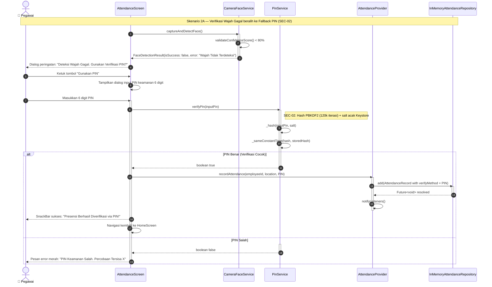

# Sequence Diagram — Skenario 2: Skenario Kritis Keamanan & Privasi
**Aplikasi:** AWALI (Absensi WAjah dan LokasI) — Presensi Pegawai  
**Milestone:** M02 — Spesifikasi Kebutuhan & Desain Arsitektur (`m02-spec`)  
**ID Kebutuhan Terkait:** `SEC-02` (Kriptografi PIN PBKDF2), `PRV-03` (Hak Penghapusan Data), `UX-02` (Mekanisme Fallback)  
**Penyusun:** Tim Pengembang AWALI  

---

## 1. Deskripsi Skenario

Dokumen ini mendokumentasikan dua alur kritis yang membuktikan implementasi nyata dari kontrol keamanan dan privasi:

* **Skenario 2A (Fallback Verifikasi PIN):** Ketika pegawai telah berada di dalam area radius kantor, namun modul kamera wajah mengalami kendala teknis (pencahayaan minim atau kegagalan deteksi berulang). Sistem secara adil mengaktifkan opsi *Fallback Verifikasi PIN* lokal yang aman (`SEC-02`) agar presensi pegawai tetap dapat dicatat tanpa mengorbankan integritas.
* **Skenario 2B (Eksekusi Hak Penghapusan Data / *Right to Erasure*):** Pegawai memutuskan untuk menghapus seluruh data pribadi lokal miliknya sesuai amanat UU No. 27 Tahun 2022 Pasal 8 melalui menu Pengaturan Privasi dalam $\le 2$ ketukan konfirmasi.

---

## 2. Diagram Sequence 2A: Wajah Gagal $\rightarrow$ Fallback PIN (`SEC-02`)



---

## 3. Diagram Sequence 2B: Hak Penghapusan Seluruh Data (`PRV-03` / *Right to Erasure*)

```mermaid
sequenceDiagram
    autonumber
    actor U as 👤 Pegawai
    participant SS as SettingsScreen
    participant CD as ConfirmDialog
    participant AP as AttendanceProvider
    participant AR as InMemoryAttendanceRepository
    participant SEC as SecureStorageService

    Note over U,SEC: Skenario 2B — Hak Penghapusan Seluruh Data (PRV-03: UU PDP Ps. 8)

    %% Ketukan 1: Buka Dialog Penghapusan
    U ->> SS : Ketuk tombol "Hapus Seluruh Data Pribadi" [Ketukan 1]
    activate SS
    SS ->> CD : showConfirmationDialog(context)
    activate CD
    CD -->> U : Tampilkan peringatan: "Peringatan: Seluruh riwayat presensi & sesi login akan dimusnahkan secara permanen. Lanjutkan?"

    %% Ketukan 2: Konfirmasi Final
    alt Pengguna Mengetuk "Hapus Permanen" [Ketukan 2]
        U ->> CD : Ketuk tombol "Ya, Hapus Permanen"
        CD ->> AP : clearAll()
        activate AP

        %% Pemusnahan Data Presensi
        AP ->> AR : clear()
        activate AR
        Note right of AR: Menghapus seluruh riwayat presensi lokal
        AR -->> AP : Future<void> resolved
        deactivate AR

        %% Pemusnahan Kredensial dan Keystore
        AP ->> SEC : clearAll()
        activate SEC
        Note right of SEC: SEC-01: Hapus token sesi, NIP, & hash PIN dari Android Keystore
        SEC -->> AP : Future<void> resolved
        deactivate SEC

        %% Reset State & Tampilan
        AP ->> AP : _records.clear(); notifyListeners()
        AP -->> SS : Consumer rebuild (Riwayat menjadi kosong)
        deactivate AP

        CD -->> SS : Navigator.pop()
        deactivate CD
        SS -->> U : Tampilkan SnackBar netral: "Seluruh data pribadi Anda telah dihapus secara permanen"
        SS ->> SS : Navigasi redirect ke layar Inisialisasi / Login Awal
    else Pengguna Membatalkan
        activate CD
        U ->> CD : Ketuk tombol "Batal"
        CD -->> SS : Navigator.pop()
        deactivate CD
        SS -->> U : Tidak ada data yang dihapus
    end
    deactivate SS
```

---

## 4. Evaluasi Kepatuhan Arsitektural

| Aspek Desain | Requirement | Bukti Implementasi pada Diagram |
|---|:---:|---|
| **Pencegahan Diskriminasi Algoritmik** | `UX-02` | Skenario 2A menjamin pegawai dengan pencahayaan minim atau hijab/kacamata tetap dapat absen via PIN alternatif tanpa ditolak sepihak. |
| **Proteksi Kriptografi Kuat** | `SEC-02` | Skenario 2A menunjukkan pemanggilan KDF PBKDF2 (120.000 iterasi) dan perbandingan waktu-konstan (*constant time*) untuk mencegah *brute-force* dan *timing attack*. |
| **Pemusnahan Ganda Menyeluruh** | `PRV-03` | Skenario 2B membuktikan bahwa perintah hapus mengeksekusi **keduanya**: basis data catatan presensi (`AR.clear()`) **dan** penyimpanan perangkat keras Keystore (`SEC.clearAll()`). |
| **Kemudahan Hak Penghapusan (≤ 2 Ketukan)** | `PRV-03` | Skenario 2B membuktikan alur pemusnahan tuntas hanya dalam 2 ketukan (Ketukan 1: Tombol menu, Ketukan 2: Dialog konfirmasi), tanpa berbelit-belit (*bebas dark pattern Roach Motel*). |
