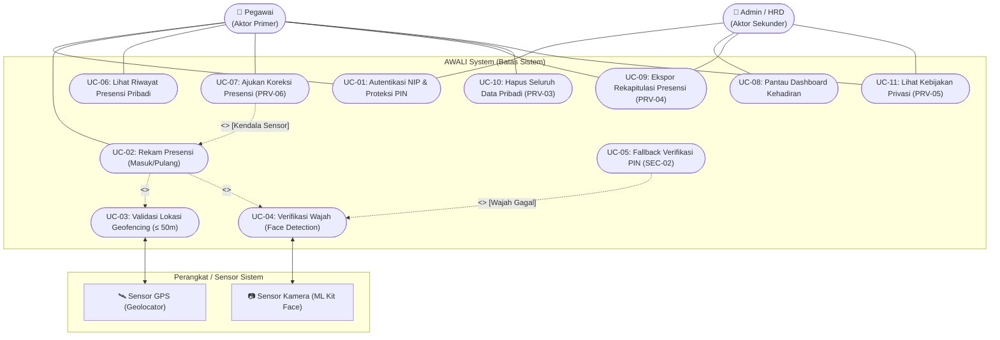

# Pemodelan Use Case Diagram
**Aplikasi:** AWALI (Absensi WAjah dan LokasI) — Presensi Pegawai  
**Milestone:** M02 — Spesifikasi Kebutuhan & Desain Arsitektur (`m02-spec`)  
**Penyusun:** Tim Pengembang AWALI  

---

## 1. Pendahuluan

Use Case Diagram menggambarkan fungsionalitas sistem AWALI dari sudut pandang aktor (pengguna langsung, pengelola, maupun sistem eksternal). Diagram ini memetakan tujuan (*goals*) yang dapat dicapai oleh setiap aktor, relasi ketergantungan wajib (`<<include>>`), relasi kondisional (`<<extend>>`), serta pemenuhan hak-hak hukum pengguna berdasarkan UU No. 27 Tahun 2022 tentang Pelindungan Data Pribadi (UU PDP).

---

## 2. Diagram Use Case (Mermaid)

---

## 3. Identifikasi dan Deskripsi Aktor

| Nama Aktor | Kategori Aktor | Peran dan Tanggung Jawab dalam Sistem |
|---|:---:|---|
| **Pegawai** | **Aktor Primer** | Pengguna langsung aplikasi yang menggunakan smartphone pribadi untuk melakukan login, verifikasi kehadiran harian (masuk/pulang), memantau riwayat presensi sendiri, serta mengelola hak privasi datanya. |
| **Admin / HRD** | **Aktor Sekunder** | Pengelola kepegawaian yang bertugas memantau statistik kehadiran harian pegawai melalui dashboard, mengelola laporan presensi bulanan, serta memverifikasi pengajuan koreksi presensi. |
| **Sensor GPS (*Geolocator*)** | **Aktor Sistem** | Komponen perangkat keras dan sistem operasi yang menyediakan koordinat garis lintang/bujur serta informasi akurasi posisi perangkat saat tombol presensi ditekan. |
| **Kamera Depan (*ML Kit*)** | **Aktor Sistem** | Komponen sensor optik yang menangkap citra wajah pegawai dan modul visi komputer yang mendeteksi keberadaan wajah valid. |

---

## 4. Rincian Use Case dan Analisis Relasi

### 4.1 Tabel Daftar Use Case

| Kode UC | Nama Use Case | Aktor Terlibat | ID Requirement Terkait | Keterangan |
|:---:|---|---|:---:|---|
| **UC-01** | Autentikasi NIP & Proteksi PIN | Pegawai, Admin HRD | `FR-01`, `FR-02`, `SEC-02` | Login akun dan otorisasi sesi lokal menggunakan PIN terenkripsi PBKDF2. |
| **UC-02** | Rekam Presensi (Masuk/Pulang) | Pegawai | `FR-05` | Alur inti pencatatan kehadiran yang menggabungkan validasi lokasi dan deteksi wajah. |
| **UC-03** | Validasi Lokasi Geofencing | Pegawai, Sensor GPS | `FR-03`, `PRV-01` | Memeriksa apakah posisi fisik pegawai berada di dalam perimeter radius $\le 50$ meter dari titik acuan kantor. |
| **UC-04** | Verifikasi Wajah | Pegawai, Kamera Depan | `FR-04`, `PRV-01` | Mendeteksi keberadaan satu wajah manusia valid (confidence $\ge 80\%$) dan mengekstrak representasi vektor fitur numerik. |
| **UC-05** | Fallback Verifikasi PIN | Pegawai | `SEC-02`, `UX-02` | Jalur alternatif verifikasi kehadiran apabila kamera mengalami kegagalan teknis berulang di lokasi kantor. |
| **UC-06** | Lihat Riwayat Presensi Pribadi | Pegawai | `FR-06` | Menampilkan seluruh rekaman kehadiran personal yang tersimpan secara lokal. |
| **UC-07** | Ajukan Koreksi Presensi | Pegawai | `PRV-06` | Mengirimkan laporan kendala presensi kepada bagian administrasi kepegawaian. |
| **UC-08** | Pantau Dashboard Kehadiran | Admin HRD | `FR-07` | Menampilkan ringkasan visual persentase kehadiran harian seluruh pegawai. |
| **UC-09** | Ekspor Rekapitulasi Presensi | Pegawai, Admin HRD | `FR-07`, `PRV-04` | Mengunduh salinan data presensi ke format dokumen portabel (CSV/PDF ringkas) sesuai UU PDP Pasal 7. |
| **UC-10** | Hapus Seluruh Data Pribadi | Pegawai | `FR-08`, `PRV-03` | Memusnahkan seluruh rekaman lokal dan kredensial dalam $\le 2$ ketukan sesuai hak *Right to Erasure* (UU PDP Pasal 8). |
| **UC-11** | Lihat Kebijakan Privasi | Pegawai, Admin HRD | `PRV-05` | Membuka teks Kebijakan Privasi formal bahasa sederhana secara langsung dari aplikasi tanpa koneksi internet. |

---

### 4.2 Analisis Relasi `<<include>>` dan `<<extend>>`

Pemilihan relasi antar use case didasarkan pada aturan rekayasa perangkat lunak yang ketat:

1. **`UC-02 (Rekam Presensi) ──<<include>>──> UC-03 (Validasi Lokasi)`**
   * **Jenis Relasi:** `<<include>>` (Wajib Dijalankan).
   * **Alasan:** Sistem presensi AWALI tidak dapat menyetujui kehadiran tanpa memastikan pegawai telah berada di lokasi kerja. Validasi lokasi adalah sub-fungsi yang **mutlak selalu dieksekusi** dalam setiap transaksi presensi.
2. **`UC-02 (Rekam Presensi) ──<<include>>──> UC-04 (Verifikasi Wajah)`**
   * **Jenis Relasi:** `<<include>>` (Wajib Dijalankan).
   * **Alasan:** Untuk mencegah kecurangan titip absen, sistem mewajibkan verifikasi wajah pada setiap alur rekam kehadiran standar.
3. **`UC-05 (Fallback PIN) ──<<extend>>──> UC-04 (Verifikasi Wajah)`**
   * **Jenis Relasi:** `<<extend>>` (Kondisional).
   * **Alasan:** Verifikasi menggunakan PIN hanya aktif **pada kondisi khusus**, yaitu ketika modul deteksi kamera wajah mengalami kegagalan teknis (misal: lensa buram atau pencahayaan minim di lokasi kantor) agar pegawai tidak dirugikan secara sepihak.
4. **`UC-07 (Ajukan Koreksi) ──<<extend>>──> UC-02 (Rekam Presensi)`**
   * **Jenis Relasi:** `<<extend>>` (Kondisional).
   * **Alasan:** Pengajuan koreksi merupakan jalur pengecualian yang hanya diakses pengguna apabila proses rekam presensi reguler mengalami kendala teknis eksternal.

